# cpp-renderer

从零实现的 C++17 光线追踪渲染器。

目标：完整跑通 **离线光追 → 实时渲染 → 高级特性 → 优化与工具化** 四个阶段，
把每一步的原理推导和踩坑记录写进 [`docs/devlog.md`](docs/devlog.md)。

---

## 效果展示

### Day 21 · OBJ 顶点法线：二十面体变成了球（但轮廓还是六边形）

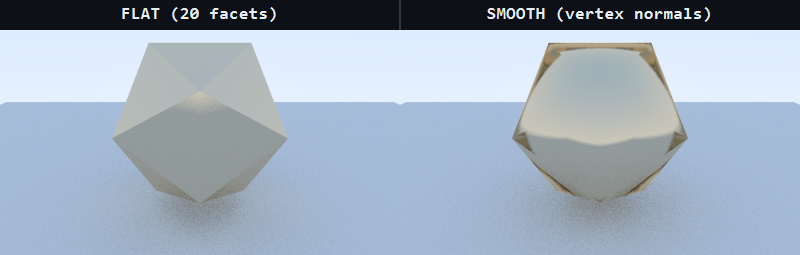

> 同一个 `icosahedron.obj`（12 顶点 / 20 三角形），只是把**面法线**换成了**顶点法线**。
> 左：20 个清晰平面；右：看起来是个球。
>
> ★ **但右图的轮廓仍然是六条直线，边缘还有折痕** ——
> 法线插值改不了剪影。**「看起来更圆」≠「几何更圆」。**

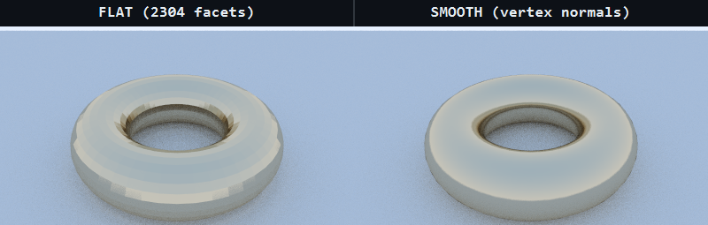

> 圆环（1152 顶点 / 2304 三角形）。左图管身上一圈圈的棱完全消失，
> 但**内圈口沿和外轮廓仍然是多边形** —— 同一个道理。

**★★ 核心推导：面积加权 ⇔ 直接累加未归一化的叉积**

```
三角形 (a,b,c) 的未归一化法线   n = (b−a) × (c−a)
它的长度                       |n| = 2 × 三角形面积

所以  Σ n_f  =  Σ ( 2·面积_f · n̂_f )  =  2 · Σ ( 面积_f · n̂_f )

→  n̂_vertex = normalize( Σ n_f )  ≡  normalize( Σ 面积_f · n̂_f )
```

> **不需要乘面积，也不需要除以面积 —— 长度自带权重。**
>
> 所以第 ① 步**绝对不能**写 `unit_vector(cross(...))`：一归一化，权重就没了，
> 退化成“等权平均”。

**为什么不能等权平均**

| | 面积 | 单位法线 |
|---|---|---|
| T_small | 0.5 | (0, 0, 1) |
| T_big | 5000（大 **10000** 倍） | (0, −1, 0) |

```
等权平均    (0,0,1) + (0,−1,0)          → 归一化 → (0, −0.707, 0.707)   各占 50%
面积加权    (0,0,1) + (0,−10000,0)       → 归一化 ≈ (0, −1, 0.0001)      大面占 99.995%
```

> ⚠️ **立方体的 3 个面面积完全相等 —— 等权平均在那里恰好是对的。**
> 又是一个“特例掩盖 bug”。

**★★★ 一个编译器完全抓不到的 bug**

第一版写成了 `d.normals[i] / std::sqrt(L2);` —— **除法结果被扔掉，法线从未归一化。**

```
[PASS] 全部 18 项测试      ← 编译 0 error 0 warning，测试也会全绿
```

因为 `Vec3` 是**类类型**，`operator/` 是个函数调用，编译器无法证明它没有副作用，
所以 **`-Wall -Wextra` 不会报 `-Wunused-value`**（而 `bool` 类型的结果被丢弃会报）。

实测这个 bug 的隐蔽程度：

| 模型 | 累加向量长度 min | max | **max/min** | 两种写法的法线夹角 |
|---|---|---|---|---|
| 二十面体 | 3.80422 | 3.80422 | **1.0000** | **1.2e-06°** |
| 圆环 | 0.04809 | 0.10596 | **2.204** | **0.36°** |

> **正二十面体 12 个顶点完全等价**（每个都被 5 个全等三角形共享）→ 累加长度全相等
> → 未归一化插值与归一化插值**代数上完全等价**。
>
> 唯一能抓住它的就是 **“法线长度必须 == 1”** 这条不变量断言（实测会得到 **3.80422**）。

**测试设计：每条只防一种错**

| 断言 | 抓到什么 |
|---|---|
| F1 `normals.size() == 12` | 没生成法线 |
| **F2 ico 长度 == 1** | **漏归一化** |
| **F3 ico 法线 == 归一化位置** | 下标错、漏面、**绕向反（180°）** |
| **F4 torus 长度 == 1** | 漏归一化（1152 个顶点的数值情况不同） |
| **F5 torus 法线 == 解析法线** | **等权平均代替面积加权**、下标映射错 |

> **F3 为什么必然成立**：正二十面体每个顶点周围 5 个全等三角形关于轴对称排列，
> 相邻夹角 72°。它们的垂直分量 `Σcos(72k°) = Σsin(72k°) = 0` 精确抵消，
> 只剩沿轴分量 → 法线方向 == 顶点位置方向。实测误差 **2.98e-05°**（来自文件 5 位小数）。

### Day 20 · 读入真实的 OBJ 模型

| 二十面体（20 个三角面） | 圆环（2304 个三角面） |
|---|---|
| 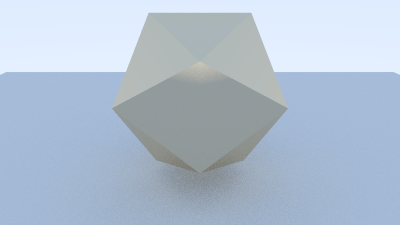 | 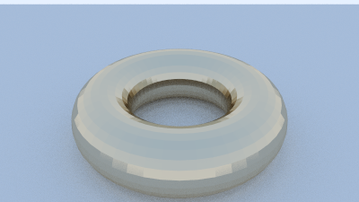 |

> 两个模型都是从 `.obj` 文本文件读进来的，不是代码里写死的几何。
> 左图能清楚看到 **5 个三角形汇在同一个顶点** —— 那是扇形三角化的直接证据。
> 二十面体是**故意的对照组**：Day 21 加上顶点法线后，它会从"20 个平面"变成一个球。

**OBJ 只有两种数据**

```
v -1 -1 -1      ← 顶点位置（positions）
f 1 2 3 4       ← 面：顶点的【编号】（tri_indices）
```

**顶点只存一份，三角形存编号** —— 立方体 8 个角要拼出 12 个三角形，
如果每个三角形自带 3 个顶点要存 36 份。用索引只需 8 份 + 36 个整数。

> 这也是 Day 21 平滑着色能成立的前提：顶点共享，法线才能一次算好、被周围所有面共用。

**三个坑（全都在这一个文件里）**

| 坑 | 说明 |
|---|---|
| **索引是 1-based** | 文件里第 1 个 `v` 用索引 `1` 表示 → 读出来必须 `- 1` |
| **索引全局累积** | 跨行计数不重置，`positions` 必须是贯穿全文的 vector |
| **`f` 可能是多边形** | 四边形/五边形都要三角化（扇形切分，从 `face[0]` 出发） |

**★ 实测：忘了减 1 会怎样**

```
positions 有 1152 个顶点  →  合法下标 0 ~ 1151
文件里最大的索引是 1152（1-based）

减 1 之后：1152 − 1 = 1151  ✓ 正好是合法上限
忘了减 1：            1152  ✗ 越界
```

**1-based 的最大索引恰好等于 N，而 0-based 的合法上限是 N−1。差一个，必然越界。**

**★★★ 变异测试：证明测试是真的**

把 `std::stoi(first) - 1` 的 `- 1` 删掉（故意注入 bug），重跑 13 条断言：

| 组 | 断言内容 | 结果 |
|---|---|---|
| A / C | 顶点数、索引数、三角形数 | ❌ 全绿 —— **数量是"形状"，平移不改变个数** |
| B | `positions[0]` / `positions[7]` 的坐标 | ❌ 全绿 —— **`-1` 只动索引，不动顶点** |
| D2 | 退化三角形数 = 0 | ❌ 绿 —— 索引整体平移后三角形依然非退化 |
| E | 空文件返回 0 | ❌ 绿 —— 跟索引无关 |
| **D1** | **所有索引 ∈ [0, 1152)** | ✅ **唯一变红的一条** |

> **结论：数量对 ≠ 内容对。形状对 ≠ 语义对。**
> 想抓"差一个"这类错误，必须有一条测试**专门检查取值范围**，
> 而不能只检查数量或几个采样点。

### Day 19 · 余弦加权重要性采样：你一直在用，只是不知道

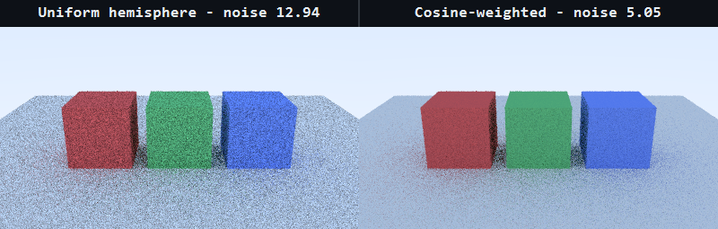

> 天光场景（`--cube-tris`），两边都是 **8 spp**。
> 左：均匀半球采样，噪声 **12.94**；右：余弦加权，噪声 **5.05**。**差 2.56 倍。**

**先证明：`normal + random_unit_vector()` 就是余弦加权**

> 设 `v` 在球面上均匀，`d = n + v`，两者与 `n` 的夹角分别是 `θ` 和 `α`：
> ```
> |d|² = 2(1 + cos α)      n·d = 1 + cos α
> cos θ = (1+cosα)/sqrt(2(1+cosα)) = cos(α/2)      →   θ = α/2
> ```
> 换元后密度恰好是 **`cosθ/π`** —— 余弦加权的定义。
>
> **实测（100 万样本，`tools/cosine_sampling_demo.cpp`）：**
>
> | | E[cos θ] | 权重标准差 | 掠射区占比 |
> |---|---|---|---|
> | 余弦加权 | **0.66639**（理论 2/3） | **0.000000** | **0.99%** |
> | 均匀半球 | 0.50025（理论 1/2） | 0.576995（理论 1/√3） | 9.95% |

**为什么它好：估计量权重是常数**

```
w = f · cosθ / pdf

余弦加权  pdf = cosθ/π   →  w = (albedo/π)·cosθ / (cosθ/π) = albedo      ← cos 和 π 全约掉
均匀半球  pdf = 1/(2π)   →  w = 2·albedo·cosθ                         ← 0~2 之间抖
```

> **两者的 `E[w]` 都是 albedo ⇒ 画面亮度完全一样，只有噪声不同。**
> 这就是重要性采样的全部：**不改变答案，只改变抖动。**

**★ 收益取决于场景（很容易说错的一句话）**

| 场景 | 余弦加权 | 均匀半球 | 差距 |
|---|---|---|---|
| Cornell Box（已开 NEE） | 8.006 | 10.095 | **1.26×** |
| 天光场景（单次弹射为主） | 5.049 | 12.936 | **2.56×** |

> **NEE 把直接光接管了**，随机弹射只负责间接光 → 能被采样策略优化的部分被压缩。
> 天光场景的照明几乎全靠单次弹射，余弦加权直接命中了被积函数的形状。
>
> **所以不能笼统地说“余弦加权好 2 倍”——必须说清“在什么场景下、和什么比”。**

### Day 18 · 多线程：加速比 ≠ 核心数

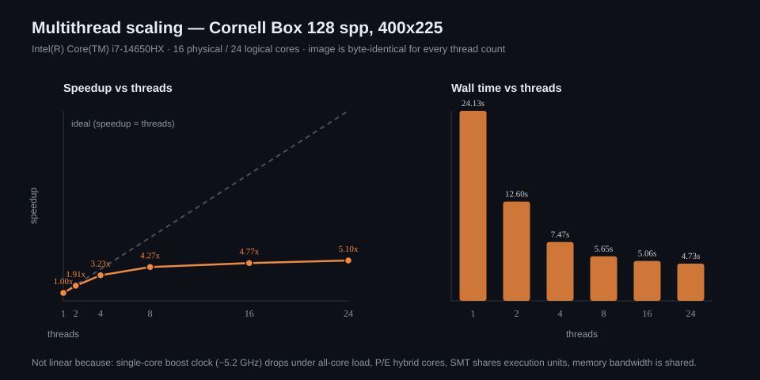

**实测（i7-14650HX、16 物理核 / 24 逻辑核、Cornell Box 128 spp）**

| 线程 | 耗时 | 加速比 | 实际占用核数 |
|---|---|---|---|
| 1 | 24.13 s | 1.00× | 0.95 |
| 2 | 12.60 s | 1.91× | — |
| 4 | 7.47 s | 3.23× | — |
| 8 | 5.65 s | 4.27× | 7.89 |
| 16 | 5.06 s | 4.77× | — |
| 24 | **4.73 s** | **5.10×** | **22.68** |

> ⚠️ **测量方差**：多次运行加速比在 **4.1× ~ 5.4×** 之间波动。
> 单线程耗时在 19.0 ~ 24.6 s 之间跳（全核版却稳定在 4.5 ~ 4.7 s）——
> 笔记本 CPU 的睿频/温度状态每次都不同，**单线程对散热状态最敏感**。
> **报告性能要写测量区间，不要挑一个好看的值。**

> **进程确实吃满了 22.68 个核的算力，墙钟却只快 4.32 倍。**
> 四个原因叠加：
> **① 功耗墙**（单线程睿频 5.2 GHz，全核只能 ~2.6 GHz，单核速度本身掉了一半）
> **② P 核 / E 核异构**（能效核吞吐约性能核的 40%）
> **③ 超线程共享执行单元**（24 逻辑核 ≠ 24 真实核）
> **④ 内存带宽竞争**
>
> **能说出“为什么没到线性加速”，比报一个漂亮数字更有说服力。**

**两个关键设计**

```cpp
// ① 每个线程一份随机数发生器（原文是 static）
inline std::mt19937& rng() {
    thread_local std::mt19937 generator;
    return generator;
}

// ② ★ 按【行号】播种，而不是按线程编号
for (int j = row_begin; j < row_end; ++j) {
    reset_rng(5489u + 2654435761u * unsigned(j));
    ...
}
```

> 按线程编号播种会导致“结果依赖于线程数”：同一行在不同线程里会拿到不同的随机序列。
> 按**行号散列**播种则得到一条强得多的不变量：
> **线程数完全不影响结果 —— `--threads 1` 和 `--threads 8` 逐字节相同**。

**两阶段渲染**

> 原来 `render()` 边算边往文件写。多线程同时写同一个 `ofstream` → 行顺序错乱 → 文件损坏。
> 改成：**阶段 1（并行）算到 `vector<uint8_t>`，阶段 2（串行）统一写出**。
> 顺带把“结果可复现”也变简单了。

| 验收 | 结果 |
|---|---|
| `--threads 1` / `8` / `auto` | **三者字节完全相同** |
| Cornell 64 spp 噪声 | 8.006（单线程版 8.049，一致） |
| 两步验收（有/无 BVH） | 字节完全相同 |
| `--grid 11` 新基准 | **182,432 B**（旧 182,468，按行播种后必然变化） |

### Day 17 · 光源采样（NEE）：整个渲染器性价比最高的一课

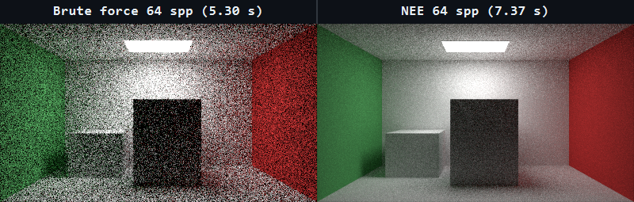

> 两边都是 **64 spp**。左边每一条光线都在“随机乱弹碰运气撞上光源”，右边主动朝光源采样。
>
> | | 暴力法 | NEE |
> |---|---|---|
> | 噪声 | **38.38** | **8.05** |
> | 耗时 | 5.30 s | 7.37 s |
>
> **1.39 倍的时间，换 4.77 倍的噪声下降。**
> 换算成等效采样数（噪声 ∝ 1/√N）：NEE 64 spp ≈ 暴力 **1455 spp**，
> 后者需要约 **120 秒** —— **≈ 16 倍加速**。
> 而且这个倍数**随光源变小而变大**；小到一定程度，暴力法**永远算不出正确的图**。

**核心：一条可以自查的恒等式**

```cpp
double pdfw = pick_pdf * pdf_area * dist2 / cos_light;
//  1 / pdfw  ==  光源在这一点看来占的立体角 Ω
```

> 不用微分，用**概率守恒**就能推出来：我们每次都采样到灯上，
> 所以落进这盏灯的**总概率是 1**，挤在它占据的立体角 Ω 里 → `pdf_ω = 1/Ω`。
>
> 实测验证：`1/pdfw = 0.1523` vs 独立算的 `Ω = 0.1522`，**差 0.07%**。
>
> 于是估计量可以写成两种等价形式：
> ```
> 贡献 = f_r · L_e · cos_surf / pdf_ω        ← 代码写法
> 贡献 = f_r · L_e · cos_surf · Ω             ← 同一件事，但全是“人话”
> ```
> **BRDF × 光源亮度 × 表面余弦 × 光源立体角。**
> 那堆 `dist²/cos/面积` 只是在**计算 Ω 而已**。

**★ 陷阱：不要在 gamma 空间比较亮度**

| | 8bit mean | 线性 mean |
|---|---|---|
| 暴力 | 89.38 | 0.18991 |
| NEE | 98.48 | 0.18945 |
| 差 | **10%** 😱 | **0.24%** ✓ |

> `√x` 是**凹函数**，所以 `E[√X] ≤ √E[X]`，**方差越大差得越多**（Jensen 不等式）。
> 暴力图噪声大 → gamma 编码后的均值系统性偏低。
> **Day 12 那条“gamma 是最后一步”的教训，在用统计量比较图像时同样成立。**

**还发现了一个必须处理的坑：重复计算**

> NEE 加上直接光后，随机弹射如果又撞上光源，同一盏灯会被算两遍（画面偏亮约 2 倍）。
> 修法：递归加 `skip_emitted` 参数，只对漫反射置位。
> 镜面金属和玻璃是 **delta 分布**（只有一个反射方向），做不了 NEE，
> 它们的 `skip_emitted` 永远是 false——反射光源仍然正常工作。

### Day 16 · 光源与 `Material::emit()`：第一张 Cornell Box

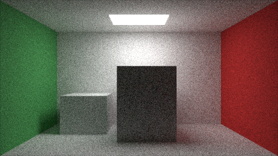

> 图形学最著名的测试场景。400×225 · **1024 spp · 82.6 s**。
>
> 图上能看到的三个物理现象：
> **① 软阴影**（光源有面积，投影边缘渐变）
> **② 颜色渗透 color bleeding**（左墙根偏绿、右墙根偏红）
> **③ 天花板被地面反照**（灯附近最亮，远处变暗）

**为什么之前一张图都没有阴影？**

> 之前的光源是背景天空：**包围整个世界、位于无穷远、占据 180°** 的巨大面光源。
> 阴影的清晰度由光源的**角尺寸**决定：太阳（0.5°）锐利，天空（180°）几乎没有。
> **想要阴影，就必须有一个"小的、有明确位置的"光源。**

**路径追踪里，"光源"到底是什么？**

> 把 Cornell Box 背景设成纯黑，盒子里就**没有任何东西会发光** → 整张图纯黑。
> 因为光线可逆：真实世界是「光源 → 物体 → 相机」，我们从相机**反着追**。
> 所以必须让某些表面**自己产出颜色**：
> ```cpp
> Color emitted = rec.mat->emitted();
> if (!rec.mat->scatter(...)) return emitted;          // 路径终止在光源上
> return emitted + attenuation * ray_color(...);        // 自发光 + 反射光
> ```
> `emitted` 默认返回黑色，所以**老材质一行都不用改**。

**噪点：1/√N 规律被精确验证**

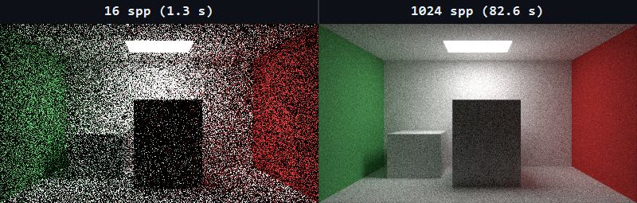

| spp | 耗时 | 高频噪声 |
|---|---|---|
| 16 | 1.3 s | **64.16** |
| 64 | 5.2 s | **38.38** |
| 1024 | 82.6 s | **9.20** |

> 64 → 1024：采样数涨 16 倍，噪声降 **4.17 倍**（理论值 √16 = 4）✓
>
> 新增 `tools/measure_noise.ps1`：用**二阶差分**而非标准差量化噪声 ——
> 画面本身有大范围渐变，标准差里混进了信号；线性区域的二阶差分恰好为 0。
>
> **想把噪声再降 10 倍，采样数得涨 100 倍 → 82.6 s 变成 2.3 小时。**
> 这就是为什么必须换算法（Day 17 的 NEE），而不是堆采样。

**1 行代码的实验：把光源换成"极亮的哑光白墙"**

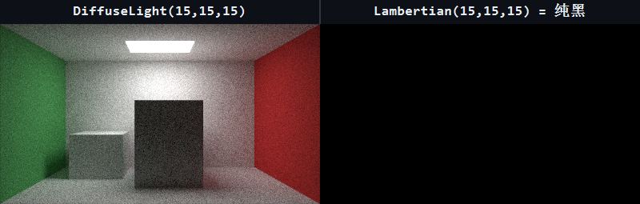

```cpp
auto light = std::make_shared<DiffuseLight>(Color(15.0, 15.0, 15.0));   // 正常
auto light = std::make_shared<Lambertian>(Color(15.0, 15.0, 15.0));     // 实验
```

| | `DiffuseLight(15,15,15)` | `Lambertian(15,15,15)` |
|---|---|---|
| 平均亮度 `mean` | 99.133 | **0.000** |
| 最大亮度 `max` | 255 | **0** |
| PNG 体积 | 229,807 B | **392 B** |

> 颜色值一模一样，只换了材质类，整张图**纯黑**。
> 因为 `Lambertian` 没重写 `emitted()`，走基类默认返回 `(0,0,0)` —— **它不注入能量**。
> 而 `attenuation = (15,15,15)` 只是个**乘数**，乘上递归出口的 `0` 还是 `0`。
>
> **发光和反光是两件事**：`emitted()` 注入能量，`attenuation` 只决定打几折。
> 一面镜子能把你照得很亮，但**关灯之后它是黑的**；荧光墙不开灯也亮。
>
> 顺带两条推论：① `albedo` 的物理范围是 `[0,1]`，超过 1 违反能量守恒会"能量雪崩"；
> ② 默认值买的是兼容性，卖的是检查 —— **"忘记重写 `emitted()`"是完全静默的**。

把这条链完整跑一遍：`tools/emitted_demo.cpp`（把 `Color` 换成单个 `float`，只留递归结构）

```powershell
g++ -std=c++17 -O2 -o build/emitted_demo.exe tools/emitted_demo.cpp
.\build\emitted_demo.exe
```

```
场景 A（灯 = Lambertian）          场景 B（灯 = DiffuseLight）
  depth 用完 → 0                   层2 命中灯 → scatter=false → 返回 15
  层1: 0 + 0.73 × 0      = 0       层3: 0 + 0.73 × 15     = 10.95
  层2: 0 + 15.00 × 0     = 0
  层3: 0 + 0.73 × 0      = 0
  ==> 0.000                        ==> 10.950
```

> 场景 A 里 `albedo = 15` 是整条链最大的数字，**但它乘的是内层的 `0`**。
> 场景 B 里递归**根本没走到底** —— 在灯那一层就终止并交出了 15。
> **能量不是从 `albedo` 来的，是从"递归终止时交出的 `emitted`"来的。**

### Day 15 · 顶点法线插值（光滑着色）

**同一个球、同一份几何，只改法线**

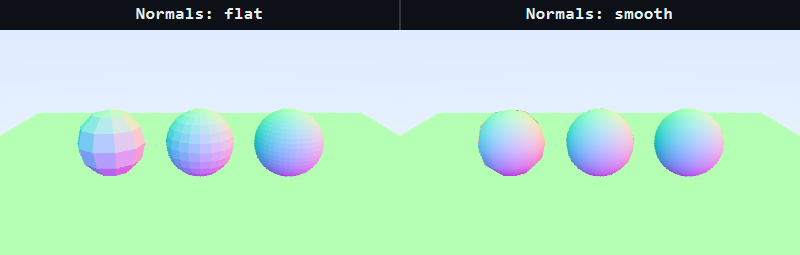

> 左：平面着色（每个面一个法线）→ 直接看出多边形结构。
> 右：光滑着色（插值顶点法线）→ 连续渐变。
> **但两边的剪影完全一样** —— 法线插值不改几何，轮廓仍然由网格密度决定。

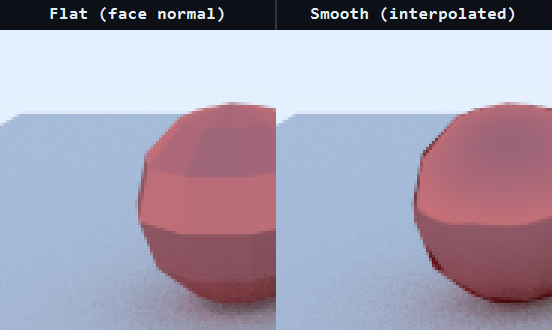

> 同一颗球（6×10 网格）放大 3 倍。左边能数出切面，右边是连续过渡。
>
> ⚠️ 第一版用 `Lambertian` 渲染，flat 和 smooth **几乎看不出差别** ——
> 因为哑光向四面八方散射，亮度是各方向入射光的**积分**，对法线不敏感。
> 换成 `Metal` 后差别立刻剧烈起来：反射方向 = `reflect(d, n)`，完全由法线决定。
> **验证一个视觉效果，必须选对材质。**

**定量结果**（441 条射线，对比解析真法线）

| 着色 | 法线最大夹角误差 |
|---|---|
| Flat | **10.55°** |
| Smooth | **1.21 × 10⁻⁶ °** |

> 差 7 个数量级不是巧合。设顶点法线 `d_k = (a_k − c)/r`，则
> ```
> n = (1−α−β)·d0 + α·d1 + β·d2 = (P − c) / r
> ```
> **位置插值和法线插值用的是同一组重心权重**，而球面的顶点法线恰好是位置的线性函数，
> 所以插值结果精确一致。（任意 OBJ 模型没有这个性质，顶点法线只能估。）

**实现：一个虚函数钩子**

```cpp
// Quad::hit() 的骨架
//   1. 平面求交            ← 固定
//   2. 算 (α, β)            ← 固定
//   3. is_interior(α, β)?   ← 钩子①：形状
//   4. 填 rec               ← 固定
//   5. set_hit_normal(α, β) ← 钩子②：法线
```

> 典型的**模板方法模式**：基类写死流程，派生类只填变化的两步。
> `Triangle` 因此只需两个函数就能从"平面着色"变成"Phong 着色"。

| 测试 | 结果 |
|---|---|
| `tests/smooth_test.cpp`（顶点 / 重心 / 平面着色 / 球面定量） | **16 / 16** |
| 全套测试 | **ALL TESTS PASSED** |
| 构建警告 | **0** |

> **Flat / Gouraud / Phong** —— 图形学面试常客：
> Flat 每面一个法线；Gouraud 在**顶点**算光照并插值**颜色**（会丢高光）；
> **Phong 插值法线，每个采样点重新算光照**（今天做的）。

### Day 14 · 三角形与网格（只重写一个虚函数）

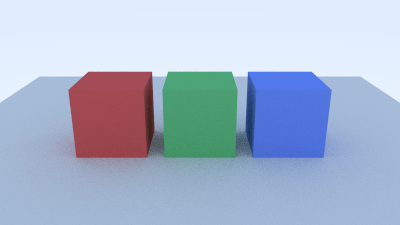

> 三个立方体、共 **36 个三角形**（每个面 2 个）+ 一块地面。400×225 · 200 spp · 4.48 s。
>
> `Triangle` 整个类只做两件事：
> ```cpp
> Triangle(a, b, c, mat) : Quad(a, b - a, c - a, mat) {}
> bool is_interior(double a, double b) const override {
>     return a >= 0 && b >= 0 && a + b <= 1;
> }
> ```
> 求交、平面参数、包围盒全部从 `Quad` 继承 —— 因为 `Quad::hit()` 里那句
> `is_interior(alpha, beta)` 是 **virtual** 调用。
> **同一份求交代码，行为由实际对象类型决定。这就是多态的价值。**

**验收：同一立方体，两种拆法必须一模一样**

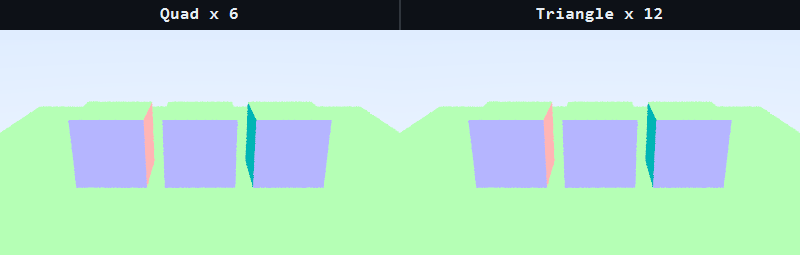

> 新增 `--normal` 调试开关：命中后直接返回法线颜色，**不弹射、不消费随机数**。
> 去掉蒙特卡洛之后，图像完全由几何决定：
> `Get-FileHash` → 6 个 Quad 和 12 个 Triangle **字节完全相同**。
>
> 为什么要专门做一个调试模式？因为正常渲染有漫反射弹射，浮点尾数差异会被
> 随机序列放大成满屏噪声错位 —— **这时候逐像素比对的失败并不能说明几何错了**。
> **想验证几何，就要先把“随机”这个变量从实验里踢出去。**

| 测试 | 结果 |
|---|---|
| `tests/triangle_test.cpp`（A 顶点不在原点 / B 朝向 / C 退化+尺度 / D 包围盒 / E 49 条射线对照） | **32 / 32** |
| 两步验收（立方体 12 个零厚度包围盒） | **字节完全相同** |

> **两个真 bug 被测试抓到：**
> 1. **传顶点当边向量** —— `Quad(a, b, c, mat)` 而不是 `Quad(a, b-a, c-a, mat)`。
>    只有 `a` 恰好在原点吇“碰巧对”。13 条测试变红，但其中 **3 条是“假绿”**（见 devlog）。
> 2. **epsilon 量纲错误** —— `len2 < 1e-8`。`len2` 是长度的四次方，
>    等价于“边长 < 0.01 就判死” ：边长为 1mm 的三角形、即 20 万面的模型，**会整个静默消失**。
>    改成与尺度无关的 `len2 < 1e-12 · |u|² · |v|²`，即 `sin²θ < 1e-12`。

### Day 13 · 第二个几何图元：平行四边形（+ 挖掉 Day 8 埋的雷）

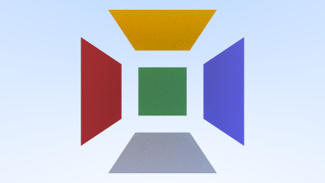

> 五个彩色 `Quad` 摆成一个开口的盒子。400×225 · 400 spp · 3.54 s。
>
> **四边形比球体还便宜**：射线与平面求交只需要一次除法，
> 再用平面内坐标 `(α, β)` 判断交点是否落在平行四边形里 ——
> 光栅化 / G-Buffer / 延迟渲染里“判断像素在不在三角形内”用的就是同一套坐标。

**今天真正的重点是那行 `pad_to_minimums()`。**

> 平行四边形是**平面几何体**，包围盒必然有一个轴厚度为 0。
> 而 Day 8 的 AABB 判据是 `t_离开 <= t_进入` 就算未命中 →
> 厚度 0 的盒子永远打不中。
>
> 后果不是“四边形不出现”，而是：
> **四边形只在用 BVH 时整片消失** —— 线性遍历根本不查包围盒，所以完全正常。
> 没有任何报错、不崩溃、不 NaN，物体只是“没了”。
> 这是最难查的一类 bug：**错在加速结构，不在几何体**。
>
> 修法是把 0 厚度撑到 `0.0001`。它**只让盒子变大，永远不会变小**，
> 所以最坏情况只是多查几次 `hit()`（变慢），**不可能算错** ——
> 修 bug 时优先找这种“失效模式良性”的方案。

**验收：两步走，一个字节都不能差**

| 步骤 | 输出 |
|---|---|
| `--quads --no-bvh`（不用加速结构） | 1,133,670 B |
| `--quads`（用 BVH） | 1,133,670 B |
| `Get-FileHash` 比对 | **完全相同** |

> 加速结构是**纯优化**，唯一职责是“少做无用功”。
> 所以它的正确性判据只有一条：**和不用它时逐像素一致**。
> 性能可以差很多，像素不能差一个。

| 测试 | 结果 |
|---|---|
| `tests/quad_test.cpp`（A 轴对齐 / B 斜四边形 / C 包围盒与 BVH 一致性） | **25 / 25** |
| `tests/aabb_test.cpp`（原 22 通过 + 1 条已知红） | **30 / 30** |
| 默认场景回归 `--grid 11` | 182,468 B，与 Day 12 一致 |

> **那条红线的处理** —— 测试变红只有两种原因：**代码写错了**（改代码）
> vs **需求变了**（改期望值 + 写清为什么）。今天是第二种。
> 只把 `false` 改成 `true` 等于**把警报器拆了**；
> 所以同时补了 5 条新断言，把新行为钉死（padding 上下界、不动厚轴、点盒子）。

### Day 12 · 补完第一本书：gamma 校正 + Schlick 菲涅尔

**① gamma 校正 —— 解决了“画面一直偏暗”**

| 修改前 | 修改后 |
|---|---|
| 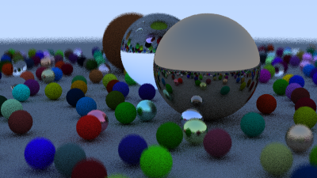 | 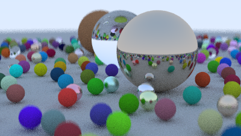 |

> 渲染器算出的**线性光强**被直接写进了文件，而所有看图软件都按 **sRGB** 解读它。
> 结果是**多开了一次方**：想要 50% 灰（应存 181），实际存了 128，显示出来只有 21.6%。
>
> 修复：写文件前先开平方。`check_gamma.ps1` 用数学恒等式严格验证：
> `new = 255.999 × sqrt(old / 255.999)` → **7299 / 7299 = 100% 通过**。
>
> 📌 **12 天来第一次“故意改变输出”** —— 字节一致判据失效，改用数学恒等式。
> **回归测试保证不倒退，不保证是对的。**

**② Schlick 菲涅尔 —— 玻璃终于会反光了**

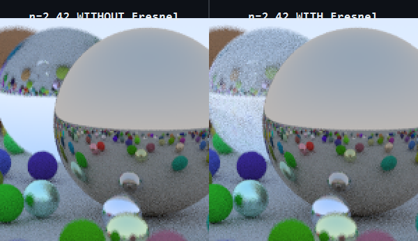

> 同一个折射率（钻石 n=2.42），**只开关 Fresnel** 这一项：
> 左边球体**暗而透明**（只有折射，0% 表面反光），
> 右边**亮、乳白、闪光**（每个界面反射 17%）。
>
> Schlick 近似：`R(θ) = R₀ + (1−R₀)(1−cosθ)⁵`，`R₀ = ((1−n)/(1+n))²`
>
> | 入射角 | 玻璃 n=1.5 | 钻石 n=2.42 |
> |---|---|---|
> | 垂直（0°） | **4%** | **17%** |
> | 掠射（→90°） | **100%** | **100%** |
>
> **一个五次多项式同时接住了两个物理极限** —— 这就是 Schlick 厉害的地方。
>
> 实现上只是一个骰子：`if (cannot_refract || reflectance(...) > random_double())`
> → **光线有 R 的概率走反射、1−R 走折射**。
> 这正是**路径追踪**与“严格光线追踪”的分界线（后者在分叉处光线数指数爆炸）。

**③ 差分热力图 —— 确认改动只发生在该发生的地方**

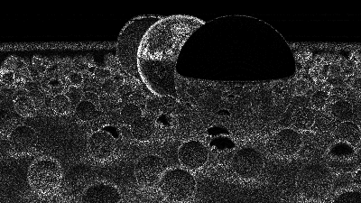

> 前后两版逐像素相减、`|Δ| × 6` 放大。
> **玻璃球边缘的两圈亮弧才是真正的 Fresnel**（掠射区反射率 → 100%）。
>
> ⚠️ 满屏细噪点**不是** Fresnel —— 是**随机序列错位**：
> Schlick 每次命中玻璃就多抽一个 `random_double()`，
> `mt19937` 是全局序列，后面所有像素的抗锯齿抖动都跟着错位。
> **想逐像素比较“改动前后”，前提是随机序列不被打乱。**

### Day 11 · 复杂度实测：BVH 的优势随规模放大

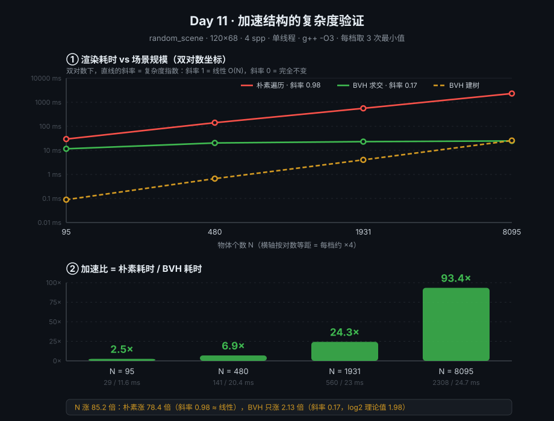

> 把场景规模从 95 个球扫到 8,095 个球，每档渲染 3 次取最小值。
> 双对数坐标下，**直线的斜率就是复杂度指数**：
>
> | | 实测斜率 | 含义 |
> |---|---|---|
> | 朴素遍历 | **0.98** | ≈ 1 → 线性 O(N) |
> | BVH 求交 | **0.17** | 远低于 1 → 对数 O(log N) |
> | BVH 建树 | 1.16 | 超线性 O(N log²N) |
>
> **N 涨 85.2 倍：朴素涨 78 倍，BVH 只涨 2.13 倍**
> （纯对数理论值 log₂ 12.98/6.57 = 1.98，**实测偏差 +7.6%**）。
> 加速比单调上升：**2.5× → 6.9× → 24.3× → 93.4×**。
>
> ⚠️ **建树线最终与求交线相交**（N=8095 时 25.5 ms vs 24.7 ms）：
> 建树是一次性成本，但它超线性增长。所以——
> **只渲染一帧**时该比「建树+求交」（仍快 46×）；
> **渲染动画多帧**时建树只付一次，该比「求交」（快 93×）。

`--grid 22` 渲染的 44×44 球阵（1,936 球）：

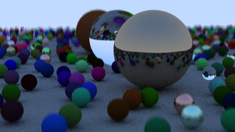

### Day 10 · 扁平化 + 一个函数名的教训（13.16 s → 1.82 s）

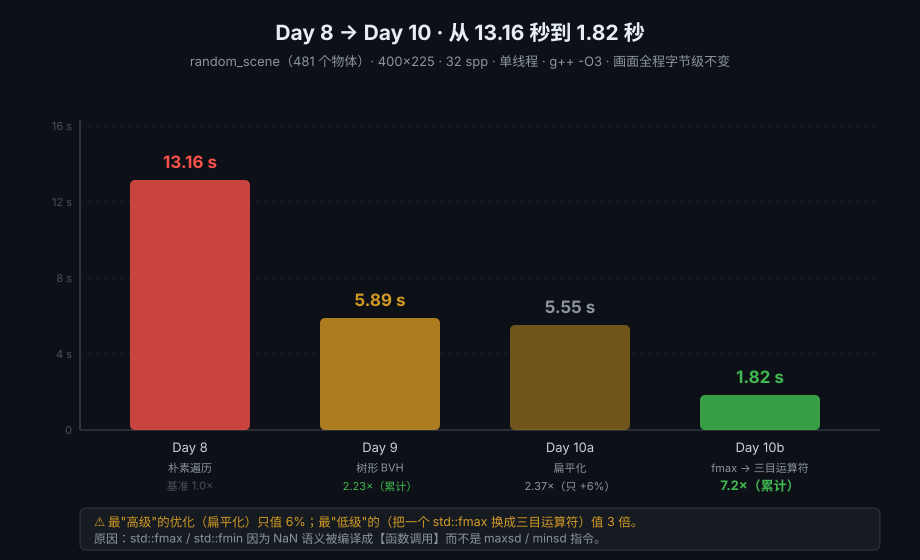

> 把 `shared_ptr` 串起来的树重写成【连续数组 + 整数下标】，节点从 88 字节压到 64 字节
> （正好一条缓存线），求交改成显式栈迭代。
>
> **但扁平化只快了 6%。** 看汇编才发现真凶：
> `std::fmax` / `std::fmin` 因为特殊的 NaN 语义，被编译成**函数调用**而不是
> `maxsd` / `minsd` 指令 —— 一次盒子测试 6 次调用，合计约 **19 亿次**。
> 换成三目运算符后：**5.55 s → 1.82 s**。
>
> **验收**：单元测试 23/23；`image.png` **172,127 B（与 Day 8/9 字节级完全一致）**；
> 累计加速 **7.2×**。

### Day 9 · BVH 加速结构（画面字节级不变，只变快）

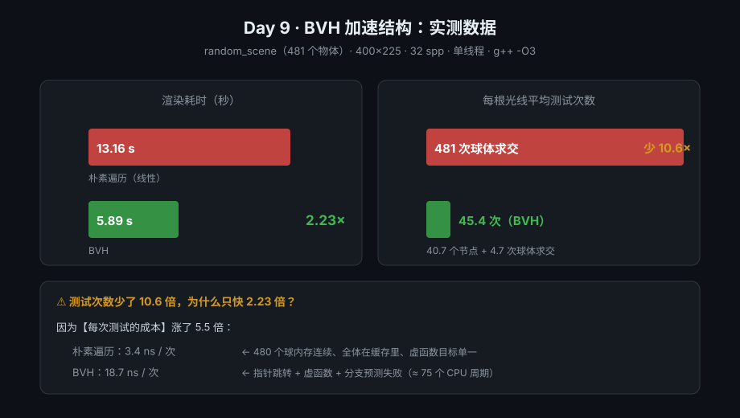

> 把 481 个物体递归地分成两堆、两堆再分两堆，形成二叉树。
> 求交时先试大盒子，没中就跳过整个子树。
>
> **验收**：单元测试 23/23；`image.png` **172,127 B（与 Day 8 字节级完全一致）**；
> 渲染 **13.16 s → 5.89 s（2.23×）**。
>
> ⚠️ **有意思的地方**：球体求交次数从 481 降到 **4.71**（少 102 倍），但总耗时只快了 2.23 倍。
> 原因是**每次测试的成本涨了 5.5 倍**——朴素遍历的 480 个球在内存里是连续的（全在缓存里），
> 而 BVH 每走一个节点都要指针跳转 + 虚函数调用 + 分支预测失败（≈ 75 个 CPU 周期）。
> 详见 [devlog Day 9「原理 4」](docs/devlog.md)。

### Day 8 · AABB 包围盒（基础设施，画面不变）

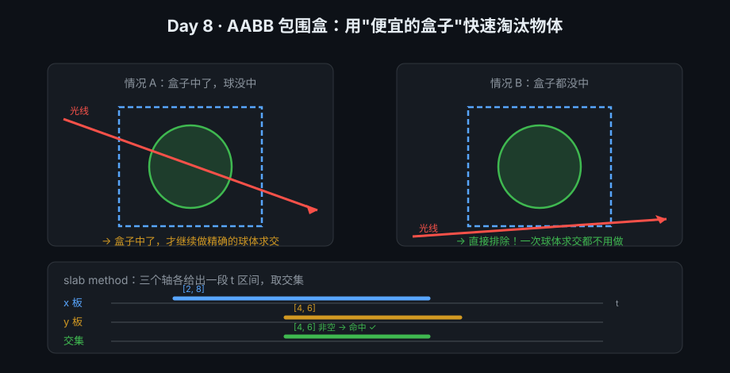

> 加速结构的第一步：给每个物体算一个"外接轴对齐长方体"。
> 光线先试盒子（便宜、无开方），没中就直接排除整个物体，中了才做精确求交。
>
> **验收**：单元测试 23/23 通过；世界包围盒输出与手工验算一致；
> 渲染结果与 Day 7 **字节级完全一致**（172,127 B）—— 加速结构的第一原则是"结果不变，只是变快"。

### Day 7 · 程序化随机场景（480 个球）


> 400×225 · 32 spp · 纯渲染 13.0 秒
>
> 金属球反射出整个世界、玻璃球折射出内部透出的小球阵列、
> 476 个小球用 80% 哑光 / 15% 金属 / 5% 玻璃的概率随机生成。

### Day 6 · 可移动相机（景深）

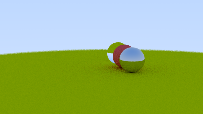

> 相机参数：`lookfrom(13,2,3)` · `lookat(0,0,0)` · `vfov 20°` · `focus_dist 13.7` · `lens_radius 0.1`

<details>
<summary>🔍 Day 6 对照实验：故意对错焦（focus_dist = 5）</summary>

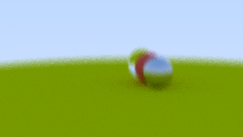

球在 13.9 米外、焦平面在 5 米处 → 球全部糊掉，但**构图与上图完全一致**。
这验证了「视口尺寸与距离同倍放大 → FOV 不变，只有焦平面移动」。

</details>

---

## 进度

| 天 | 内容 | 状态 |
|:--:|---|:--:|
| 1 | CMake 骨架、`vec3` / `ray` / `camera`、PPM 输出、渐变背景 | ✅ |
| 2 | 球体求交、法线着色、`Hittable` 抽象、多物体场景 | ✅ |
| 3 | 抗锯齿（三层循环 + 抖动采样）、Lambertian 漫反射（递归弹射） | ✅ |
| 4 | 材质系统：`Lambertian` / `Metal` / `Dielectric`、递归深度限制 | ✅ |
| 5 | 景深：薄透镜模型、`random_in_unit_disk`、弥散圆公式 | ✅ |
| 6 | 可移动相机：基向量 `u/v/w`、`vfov`、`focus_dist` | ✅ |
| 7 | 程序化随机场景（480 个球） + 性能测量方法论 | ✅ |
| 8 | **AABB 包围盒**（slab method + 单元测试体系） | ✅ |
| 9 | **BVH 递归建树**（结果字节级不变，2.23× 加速） | ✅ |
| 10 | **扁平化 BVH + 干掉 `std::fmax` 函数调用**（累计 **7.2×**） | ✅ |
| 11 | **复杂度实测**：双对数性能曲线（斜率 0.98 vs 0.17）+ 可重置 RNG | ✅ |
| 12 | **gamma 校正 + Schlick 菲涅尔** —— 《Ray Tracing in One Weekend》**全部完成** 🎓 | ✅ |
| 13 | **`Quad` 平行四边形** + `pad_to_minimums()` 修掉零厚度包围盒（两步验收字节一致） | ✅ |
| 14 | **`Triangle` 三角形** —— 只覆盖一个虚函数；退化保护 + 尺度无关 epsilon；立方体两种拆法字节一致 | ✅ |
| 15 | **顶点法线插值（Phong 着色）** —— 虚函数钩子；误差 10.55° → 1.2e-06° | ✅ |
| 16 | **光源与 `emit()`** —— 第一张 Cornell Box（软阴影 / 颜色渗透）；噪声量化工具 | ✅ |
| 17 | **光源采样 NEE** —— 噪声 38.38 → 8.05（等效 **16×** 加速）；`1/pdfw = 立体角` 自查恒等式 | ✅ |
| 18 | **多线程** —— 24 逻辑核 **4.32×**（受功耗墙限制）；`thread_local` + 按行播种；线程数不影响结果 | ✅ |
| 19 | **余弦加权重要性采样** —— 证明 RTIOW 写法已是余弦加权（E[cos]=2/3）；权重标准差 **0 vs 0.577** | ✅ |
| 20 | **OBJ 网格读取** —— `v`/`f` 解析 + 扇形三角化；2304 面的圆环压 BVH；第一次由学员自己写 13 条测试 + **变异测试** | ✅ |
| 21 | **OBJ 顶点法线** —— 面积加权平均（= 累加未归一化叉积）；二十面体变成球 | ✅ |
| — | 后续：纹理映射 → 显式 PDF / MIS → 成品大图与视频 | 📋 |

---

## 性能数据（实测）

### 复杂度随规模的变化（Day 11）

`120×68 · 4 spp · 每档 3 次取最小 · 不含写文件`

| N | 建树 ms | 朴素 ms | BVH 求交 ms | 加速比 |
|---:|---:|---:|---:|---:|
| 95 | 0.089 | 29.4 | 11.6 | 2.5× |
| 480 | 0.668 | 141.0 | 20.4 | 6.9× |
| 1,931 | 4.016 | 559.6 | 23.0 | 24.3× |
| 8,095 | 25.509 | 2,308.0 | 24.7 | **93.4×** |

复现：`\build\raytracer.exe --bench` → `output/bench.csv` → `\tools\plot_bench.ps1`

### 单场景优化历程

| 场景 | 物体数 | 平均弹射层数 | 求交次数 | 纯渲染耗时 |
|---|---|---|---|---|
| `simple_scene` | 4 | 1.63 | 1,874 万 | **0.28 s** |
| `random_scene` | 480 | 2.75 | ≡37.96 亿（朴素） | **13.03 s** → **1.82 s**（BVH） |

求交吞吐量 ≈ **2.9 亿次 / 秒**（单线程）
> ⚠️ 讨论渲染性能请**直接计时 `raytracer.exe`**。
> `tools/run.ps1` 报的"总耗时"包含 CMake 编译（≈ 2.6 s），会严重干扰判断 —— 详见
> [devlog Day 7「原理 3」](docs/devlog.md)。

---

## 目录结构

```
cpp-renderer/
├── CMakeLists.txt
├── README.md
├── .gitignore
├── include/          # 头文件（全部基于接口/组合设计）
│   ├── rtweekend.h        工具箱：公共头、常量、随机数（含 reset_rng）
│   ├── vec3.h             三维向量（身兼位置/方向/颜色）+ 反射/折射
│   ├── ray.h              光线 P(t) = O + tD（预存方向倒数）
│   ├── color.h            **颜色编码：线性光强 → gamma 空间 → 字节**
│   ├── aabb.h             轴对齐包围盒 + slab method 求交
│   ├── bvh.h              BVH 树（连续数组 + 整数下标，无虚函数遍历）
│   ├── camera.h           可移动相机：像素坐标 -> 光线
│   ├── hittable.h         HitRecord + Hittable 抽象接口（hit / bounding_box）
│   ├── sphere.h           球体求交 + 包围盒
│   ├── quad.h             平行四边形（第二个图元；三角形只需覆盖 is_interior）
│   ├── triangle.h         **三角形 —— 继承 Quad，只重写 is_interior 一行**
│   ├── mesh.h             球面网格（三角形拼球，可选顶点法线）
│   ├── obj_loader.h       **OBJ 文本读取（v / f，扇形三角化）**
│   ├── diffuse_light.h    **纯光源：只发光不散射**
│   ├── hittable_list.h    物体列表（组合模式，将来换 BVH 只需改这里）
│   ├── material.h         Material 抽象接口
│   ├── lambertian.h       哑光
│   ├── metal.h            金属（镜面 + fuzz）
│   └── dielectric.h       玻璃 / 水 / 钻石（折射 + 全反射 + **Schlick 菲涅尔**）
├── src/
│   └── main.cpp            ray_color + 场景构建 + render() + --bench 基准测试
├── tests/
│   ├── aabb_test.cpp       AABB 单元测试（独立可执行，1 秒反馈）
│   ├── quad_test.cpp       Quad 单元测试（α/β 手算验算 + BVH 一致性）
│   ├── triangle_test.cpp   Triangle 单元测试（含 49 条射线对比两种拆法）
│   ├── smooth_test.cpp     光滑着色（含定量：插值法线 vs 解析真法线）
│   └── obj_test.cpp        **OBJ 读取（13 条断言：数量/坐标/不变量/异常路径）**
├── models/                 **测试用 OBJ 模型（由 tools/gen_obj.ps1 生成）**
├── tools/
│   ├── run.ps1            一键：编译 -> 渲染 -> 转 PNG（分阶段报耗时）
│   ├── test.ps1           一键：编译 + 运行所有单元测试
│   ├── plot_bench.ps1     读 bench.csv -> 生成双对数性能曲线 SVG
│   ├── check_gamma.ps1    **验证 gamma 数学恒等式（可证伪）**
│   ├── measure_noise.ps1  **用二阶差分量化高频噪声（不含信号）**
│   ├── plot_threads.ps1   **自动测量线程扩展性 → 生成加速比曲线 SVG**
│   ├── emitted_demo.cpp   **把 ray_color 的递归剥光，用真数字跑一遍**
│   ├── cosine_sampling_demo.cpp **实测 E[cosθ]：证明余弦加权，量权重方差**
│   ├── stream_demo.cpp    **流语法演示（istringstream / >> / getline / stoi）**
│   ├── gen_obj.ps1        生成测试模型 cube / icosahedron / torus
│   ├── compare_crop.ps1   **同区域裁切放大对照（调试用）**
│   ├── publish.ps1        一键：效果图归档 -> commit -> push
│   └── ppm2png.ps1        PPM(P3) -> PNG 转换
├── docs/
│   ├── devlog.md          技术日志（逐日原理推导 + 踩坑）
│   ├── cpp-notes.md       **C++ 笔记（从 devlog 抽出的语言知识点，按 Day + 主题索引）**
│   └── api.md             函数总览（速查手册）├── gallery/          # 各阶段效果图（入库存档）
└── output/           # 运行时产物（不入库）
```

---

## 构建与运行

```bash
cmake -B build -G "MinGW Makefiles" -DCMAKE_BUILD_TYPE=Release
cmake --build build -j
./build/raytracer.exe                 # Windows (MinGW)
./build/raytracer.exe --grid 22       # 改球阵规模（half=22 → 44×44，约 1900 球）
./build/raytracer.exe --bench         # 扫规模跑基准 -> output/bench.csv
./build/raytracer.exe --quads         # 四边形场景（Day 13）
./build/raytracer.exe --cube-quads    # 立方体：每面 1 个 Quad
./build/raytracer.exe --cube-tris     # 立方体：每面 2 个 Triangle
./build/raytracer.exe --sphere-flat   # 球面网格：平面着色
./build/raytracer.exe --sphere-smooth # 球面网格：光滑着色（顶点法线插值）
./build/raytracer.exe --cornell       # Cornell Box（Cornell 盒子 + 面光源）
./build/raytracer.exe --cornell --no-nee  # 关掉 NEE，回到暴力路径追踪（A/B 对比）
./build/raytracer.exe --obj-ico       # OBJ 模型：二十面体（顶点法线插值，看起来像球）
./build/raytracer.exe --obj-ico-flat  # 对照：平面着色（20 个清晰平面）
./build/raytracer.exe --obj-torus     # OBJ 模型：圆环（2304 个三角面，压 BVH）
./build/raytracer.exe --obj-torus-flat # 对照：平面着色
./build/raytracer.exe --threads 8     # 指定线程数（默认 = 硬件线程数）
./build/raytracer.exe --uniform-hs    # 对照：均匀半球采样（“差”的那种，用于演示重要性采样）
./build/raytracer.exe --normal        # 法线着色（确定性，用于几何比对）
./build/raytracer.exe --quads --spp 400   # 自定义采样数
./build/raytracer.exe --quads --no-bvh    # 关掉 BVH，用于两步验收
```

一键脚本（推荐）：

```powershell
.\tools\test.ps1                             # 单元测试（1 秒反馈）
.\tools\run.ps1                              # 编译 + 渲染 + 转 PNG
.\tools\gen_obj.ps1                          # 生成 models/ 下的测试模型
.\tools\plot_bench.ps1                       # bench.csv -> 性能曲线图
.\tools\publish.ps1 -Message "Day 11" -Image day11.png   # 发布到 GitHub
```

输出：`output/image.ppm` → `output/image.png`

---

## 设计要点

- **组合模式**：`HittableList` 本身也是一个 `Hittable`，所以"一堆物体"和"一个物体"可以同样对待。
  后来把线性遍历换成 `BVH` 时，**`main.cpp` 一行都没改** —— 设计伏笔直接兜现。
- **不变量优先**：`BVH::bounding_box()` 直接返回建树时算好的盒子（缓存）。
  代价是树必须**不可变**——否则盒子会对不上内容，导致 BVH “错得看不出来”。
- **包围盒宁可偏大，绝不能偏小**：偏大只是多查几次 `hit()`（慢），偏小会漏掉命中（错）。
  所以 `pad_to_minimums()` 把零厚度轴撑到 `0.0001` 是**安全**的修法 ——
  最坏后果是性能损失，不可能是错误图像。
- **加速结构的验收方式**：和不用它时**逐像素一致**。
  这个检查的价值在于能抓住“不加速时看起来完全正常”的 bug（如零厚度包围盒）。
- **可重复性优先**：`reset_rng()` 让随机序列可重置。
  **跨进程**渲染能字节一致（默认种子 5489）；**同进程内**连续渲染必须显式重置。
  这是基准测试能“只换算法、不换场景”的前提。
- **色彩空间分离**：渲染全程在**线性光强**空间做（物理正确），
  写文件前才在 `color.h` 里转成 **sRGB**。两道工序不能混 ——
  漏掉第二道就是“画面偏暗 2.3 倍”的经典 bug。
- **蒙特卡洛分叉**：玻璃表面用 `reflectance(...) > random_double()` 掋骰子，
  以 R 的概率走反射、1−R 走折射。
  这就是**路径追踪**与“严格光线追踪”的分界线（后者在分叉处光线数指数爆炸）。
- **接口分离**：`Hittable` 回答"撞到了吗"，`Material` 回答"往哪弹、打几折"。
  加新材质（比如 `Isotropic`）时，`ray_color` 和求交代码完全不用动。
- **多态降本**：`Triangle` 没有 `hit()`、没有包围盒代码，只重写了一个 `is_interior`。
  因为 `Quad::hit()` 里那句 `is_interior(alpha, beta)` 是 virtual 调用 ——
  **同一份求交代码，行为由对象真实类型决定**。加下一个图元（圆盘/椭圆）也只需要一个函数。
- **索引化网格**：OBJ 只存一份顶点 + 一堆编号，不存重复顶点。
  立方体只有 8 个角却要拼 12 个三角形，用索引只需 8 份（而不是 36 份）。
  这同时也是**平滑着色能成立的前提**：顶点共享，法线才能被周围所有面共用。
- **测试要能证伪**：13 条断言全绿**不代表测试有效**。
  故意把代码改坏（删掉 `- 1`）后**只有 1 条变红** —— 说明其余 12 条都防不住这类错误。
  **数量对 ≠ 内容对**：检查取值范围的不变量测试，是唯一能抓“差一个”的手段。
- **面积加权白送**：三角形未归一化法线的**长度就是 2×面积**，
  所以“累加叉积再归一化”自动就是面积加权平均 —— 不用乘面积，也不用除以面积。
  代价是：**绝对不能提前 `unit_vector`**，一归一化权重就没了。
- **索引化网格是平滑的必要条件**：顶点只存一份 → 被多个面共享 → 面法线才能累加。
  每面自带 3 个顶点的格式（如 STL）必须先**焊接顶点**（weld）才能平滑。
  副产品：**边界顶点只被 1 个面共享 → 它的法线做不平滑**，这不是 bug，是信息不足。
- **两个虚函数钩子**：`is_interior` 控制**形状**，`set_hit_normal` 控制**法线**。
  这就是模板方法模式：`Quad::hit()` 的流程写死，派生类只填变化的两步。
  Day 16 加圆盘、椭圆还是只写这两个函数。
- **输出参数**：`scatter(r_in, rec, attenuation, scattered)` 用引用传出两个结果，
  配合 `bool` 返回"是否散射"。
- **可空输出用指针**：`render(..., std::ostream* out)` —— `nullptr` 表示“只算不写”。
  引用做不到这件事，因为**引用不能为空**。
- **递归深度限制**：玻璃的全反射会让递归无限深入（曾造成栈溢出 `0xC00000FD`），
  用 `max_depth` 作保险丝。

---

## 技术日志

完整推导（球体求交、Snell 定律、薄透镜成像、弥散圆、相机基向量…）见
[`docs/devlog.md`](docs/devlog.md)。函数速查见 [`docs/api.md`](docs/api.md)。
C++ 语言知识点（语法 / 标准库 / 编译期陷阱）单独整理在 [`docs/cpp-notes.md`](docs/cpp-notes.md)。
